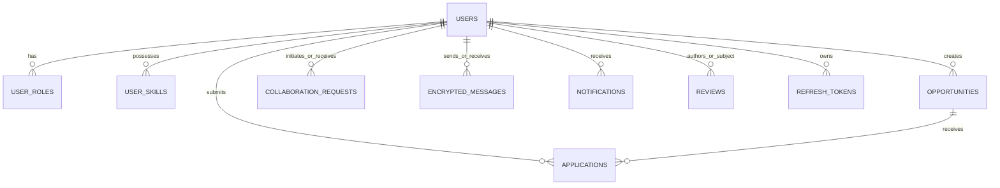

# CineVantaara — Relational Database Schema & Data Dictionary

Database Engine: **PostgreSQL** (with Flyway Version-Controlled Migrations)

---

## 1. Entity-Relationship Overview

---

## 2. Table Definitions

### `users`
| Column | Type | Constraints | Description |
|---|---|---|---|
| `id` | VARCHAR(64) | PRIMARY KEY | Unique creator identifier (e.g., `user-director-1`) |
| `name` | VARCHAR(255) | NOT NULL | Professional or stage name |
| `email` | VARCHAR(255) | UNIQUE, NOT NULL | Studio email address |
| `password_hash` | VARCHAR(255) | NOT NULL | Salted BCrypt password hash |
| `avatar_url` | TEXT | NULL | Professional headshot / avatar URI |
| `headline` | VARCHAR(255) | NULL | Cinematic title / headline |
| `bio` | TEXT | NULL | Creative artistic bio & statement |
| `location` | VARCHAR(255) | NULL | Geographic production bases (e.g. Mumbai & London) |
| `experience_years`| INT | DEFAULT 0 | Active years in the film industry |
| `active_role` | VARCHAR(64) | NOT NULL | Currently active visual persona (e.g. DIRECTOR, PRODUCER) |
| `is_verified` | BOOLEAN | DEFAULT FALSE | Guild / union / IMDb verified badge |
| `is_available` | BOOLEAN | DEFAULT TRUE | Availability for new productions |
| `rating` | NUMERIC(3,2) | DEFAULT 5.0 | Aggregate collaboration rating |
| `review_count` | INT | DEFAULT 0 | Total peer reviews received |
| `created_at` | TIMESTAMP | DEFAULT NOW() | Registration timestamp |

### `user_roles`
Composite table mapping multiple professional disciplines per user:
- `user_id`: VARCHAR(64) REFERENCES users(id) ON DELETE CASCADE
- `role`: VARCHAR(64) NOT NULL (e.g., 'DIRECTOR', 'WRITER', 'ACTOR')

### `opportunities`
- `id`: VARCHAR(64) PRIMARY KEY
- `producer_id`: VARCHAR(64) REFERENCES users(id)
- `producer_name`: VARCHAR(255) NOT NULL
- `producer_company`: VARCHAR(255) NULL
- `title`: VARCHAR(255) NOT NULL
- `film_category`: VARCHAR(64) NOT NULL ('FEATURE_FILM', 'SHORT_FILM', 'OTT_SERIES', etc.)
- `description`: TEXT NOT NULL
- `required_role`: VARCHAR(64) NOT NULL
- `min_experience_years`: INT DEFAULT 0
- `location`: VARCHAR(255)
- `is_remote_allowed`: BOOLEAN DEFAULT FALSE
- `compensation_type`: VARCHAR(64) ('PAID', 'UNION_SCALE', 'PROFIT_SHARE', 'NEGOTIABLE')
- `compensation_details`: VARCHAR(255)
- `deadline`: DATE
- `status`: VARCHAR(32) DEFAULT 'OPEN'

### `applications`
- `id`: VARCHAR(64) PRIMARY KEY
- `opportunity_id`: VARCHAR(64) REFERENCES opportunities(id) ON DELETE CASCADE
- `opportunity_title`: VARCHAR(255) NOT NULL
- `applicant_id`: VARCHAR(64) REFERENCES users(id)
- `applicant_name`: VARCHAR(255) NOT NULL
- `applicant_role`: VARCHAR(64) NOT NULL
- `pitch_note`: TEXT NOT NULL
- `showreel_url`: TEXT NULL
- `status`: VARCHAR(32) ('PENDING', 'UNDER_REVIEW', 'SHORTLISTED', 'ACCEPTED', 'REJECTED')

### `collaboration_requests`
- `id`: VARCHAR(64) PRIMARY KEY
- `sender_id`: VARCHAR(64) REFERENCES users(id)
- `receiver_id`: VARCHAR(64) REFERENCES users(id)
- `project_title`: VARCHAR(255) NOT NULL
- `role_proposed`: VARCHAR(255) NOT NULL
- `message`: TEXT NOT NULL
- `status`: VARCHAR(32) ('PENDING', 'ACCEPTED', 'REJECTED')

### `encrypted_messages`
- `id`: VARCHAR(64) PRIMARY KEY
- `conversation_id`: VARCHAR(128) NOT NULL (e.g., `cv_chat_user1_user2`)
- `sender_id`: VARCHAR(64) REFERENCES users(id)
- `recipient_id`: VARCHAR(64) REFERENCES users(id)
- `cipher_text`: TEXT NOT NULL (Base64 `IV:CIPHERTEXT` encoded AES-GCM payload)
- `is_read`: BOOLEAN DEFAULT FALSE

### `reviews`
- `id`: VARCHAR(64) PRIMARY KEY
- `author_id`: VARCHAR(64) REFERENCES users(id)
- `target_user_id`: VARCHAR(64) REFERENCES users(id)
- `project_title`: VARCHAR(255) NOT NULL
- `rating`: INT CHECK (rating >= 1 AND rating <= 5)
- `feedback`: TEXT NOT NULL
- **Constraint:** Unique composite constraint on `(author_id, target_user_id, project_title)` prevents duplicate review spam.

### `audit_logs`
- `id`: VARCHAR(64) PRIMARY KEY
- `admin_id`: VARCHAR(64) REFERENCES users(id)
- `admin_name`: VARCHAR(255) NOT NULL
- `action`: VARCHAR(128) NOT NULL
- `target_type`: VARCHAR(64)
- `target_id`: VARCHAR(64)
- `details`: TEXT
- `ip_address`: VARCHAR(64)
