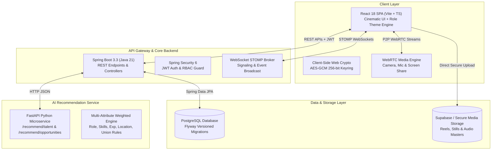

# CineVantaara — Project Architecture & System Design
**Tagline:** *"Where Stories Meet Talent"*

---

## 1. System Overview
CineVantaara is designed as a distributed, high-performance cinematic ecosystem integrating:
1. **Cinematic Frontend Client** (React 18 / TypeScript / Tailwind CSS / Framer Motion / Lucide / Web Crypto)
2. **Core Backend Microservice** (Java 21 / Spring Boot 3.3 / Spring Security / Spring Data JPA / WebSocket STOMP)
3. **Database Layer** (PostgreSQL / Flyway Relational Migrations + Dual H2 in-memory mode for development)
4. **AI Recommendation Microservice** (Python 3 / FastAPI / Mathematical Multi-Attribute Weighted Compatibility Engine)
5. **Real-Time P2P Streaming Engine** (WebRTC Audio/Video with WebSocket Signaling & AES-GCM Client-Side End-to-End Encryption)

---

## 2. Architecture Diagram

---

## 3. Key Subsystems

### A. Role Theme Engine
- Supports 12+ distinct cinema professions (Director, Producer, Writer, Actor, Cinematographer, Editor, Composer, VFX Artist, Makeup Artist, Costume Designer, Art Director, Sound Designer).
- Real-time CSS custom property injection dynamically shifts visual branding, background gradients, card borders, and specialized workbenches without refreshing the browser.

### B. Client-Side End-to-End Encryption (E2EE)
- Implemented with the browser's native `window.crypto.subtle` (AES-GCM 256-bit).
- Private keys reside only in client storage; server stores only `IV:CIPHERTEXT`.
- **Zero Backdoor Guarantee:** Platform administrators, moderators, and database managers cannot read private creator communications.

### C. Mathematical AI Matching Engine
- Python FastAPI microservice that computes true mathematical affinity scores between job requirements and talent candidate profiles.
- Score Breakdown:
  - Role Compatibility: 30%
  - Skill Alignment: 30%
  - Experience Depth: 15%
  - Geographic Alignment: 15%
  - Availability & Verification: 10%
- No fabricated scores; full visibility of matched and missing skills.
